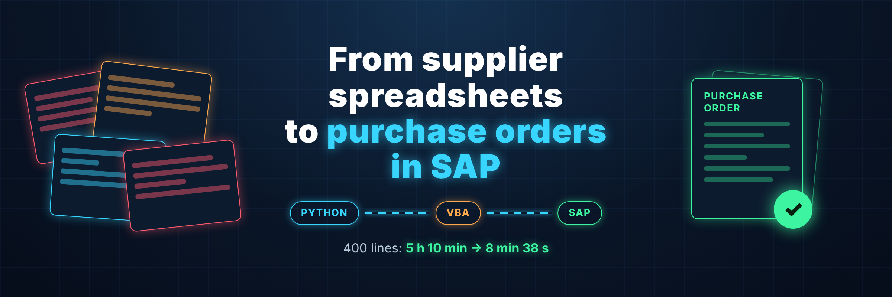
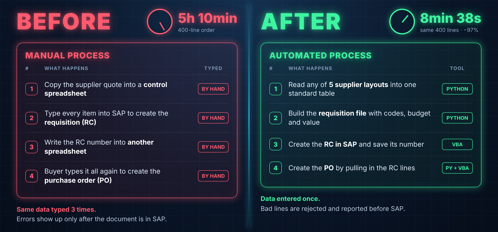
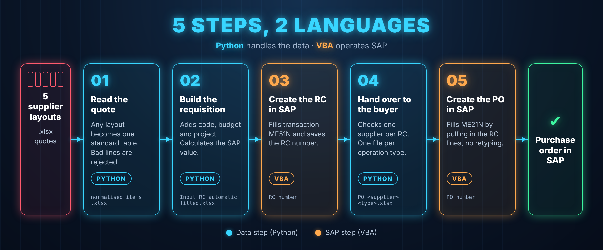
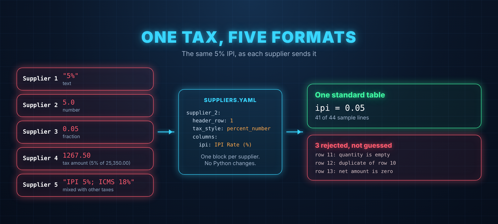
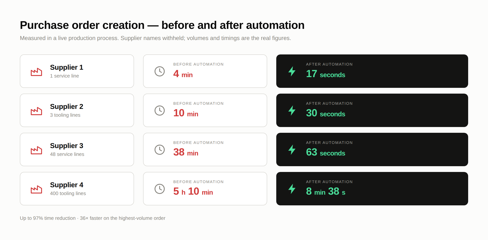

# SAP Purchasing Automation



Turns supplier quote spreadsheets into purchase requisitions and purchase orders in SAP, with no retyping.

| | |
|---|---|
| **Problem** | The same supplier data was typed by hand three times, by two teams, before a purchase order existed in SAP. A 400-line order took more than five hours, and typing mistakes only appeared once the document was already in SAP. |
| **Where** | Purchasing at Toyota do Brasil, as part of "Payments Postponed", a top 3 Toyota Business Practices project of 2026. |
| **Solution** | Python prepares the data from the spreadsheet and VBA creates the requisition and the purchase order in SAP by itself. |
| **Result** | Up to 97% less time per order (5 h 10 min → 8 min 38 s on a 400-line order), measured in production. The task moved from each buyer to one person, so the process became standard. |
| **Tools** | Python (openpyxl) · VBA · SAP GUI Scripting · Excel |

> The company code can't be published, so this is a rebuild with fake data (codes like `PL01`, `MAT-100441`). The process and the business rules are the real ones.

---

## The problem



To buy tooling or a service, Purchasing creates two documents in SAP: a **requisition (RC)**, the internal request to buy, and then a **purchase order (PO)**, the document sent to the supplier.

Suppliers send their prices in spreadsheets. Before this tool, someone copied the quote into a control sheet, typed every line into SAP to create the RC, wrote the RC number into another sheet, and then the buyer typed everything again to create the PO.

## The solution



**Python handles the data, VBA operates SAP.** The SAP steps are in VBA because it runs on any company computer without installing anything.

| Step | What it does | Tool |
|---|---|---|
| 01 Read the quote | Turns the supplier spreadsheet into one standard table and rejects bad lines | Python |
| 02 Build the requisition | Adds internal code, budget and project, and calculates the value SAP expects | Python |
| 03 Create the RC | Fills in the SAP requisition screen and saves the RC number | VBA |
| 04 Hand over to the buyer | Creates one file per supplier and operation type (tooling or service) | Python |
| 05 Create the PO | Creates the PO in SAP by pulling in the RC lines instead of typing them again | VBA |

Three business rules are checked by the tool, not left to whoever does the job that day:

1. Tooling is valued at net price plus IPI tax; services with all taxes.
2. One RC belongs to one supplier.
3. One PO covers one operation type, so an RC creates at most two POs.

## Reading different supplier files



At work, every supplier sent its own layout, and someone still had to convert it by hand. This rebuild solves that: it reads **5 different supplier formats**. The same 5% tax, for example, can arrive as `"5%"`, `5.0`, `0.05`, a currency amount or inside `"IPI 5%; ICMS 18%"`.

Each supplier's layout is written in a settings file (`shared/suppliers.yaml`), so adding a supplier means copying a block and changing the column names, with no programming. A line with a missing quantity, a zero price or an unknown item is **rejected and reported**, instead of becoming a wrong document in SAP.

## Results



Measured in production:

| Order size | Manual | Automated |
|---|---|---|
| 1 service line | 4 min | 17 s |
| 3 tooling lines | 10 min | 30 s |
| 48 service lines | 38 min | 63 s |
| 400 tooling lines | 5 h 10 min | 8 min 38 s |

Manual time grows with every line. Automated time barely changes, so the bigger the order, the bigger the gain.

## Files

| Folder | What is in it |
|---|---|
| `01-supplier-intake/` | Step 01 (Python) and 5 sample supplier files |
| `02-requisition-builder/` | Step 02 (Python) |
| `03-requisition-sap/` | Step 03 (VBA macro for SAP) |
| `04-po-handover/` | Step 04 (Python) |
| `05-purchase-order-sap/` | Step 05 (VBA macro for SAP) |
| `shared/` | Supplier settings, item master and Excel templates |
| `docs/` | Images |

Steps 01 and 02 run on the sample data without SAP:

```bash
pip install -r requirements.txt
cd 01-supplier-intake/src
python intake.py --input ../sample_data/supplier_2.xlsx
cd ../../02-requisition-builder/src
python build_requisition.py --input ../../01-supplier-intake/src/normalised_items.xlsx
```

## Background

Based on my work in purchasing at Toyota do Brasil, where I built the SAP automation (requisition and purchase order) inside a three-person process project. The full case is on [Notion](https://lucasnunesf.notion.site/Automating-the-purchasing-cycle-in-SAP-a73917c89c1783d49fb301b2a65ab928).

---

Lucas Fernandes Nunes · [LinkedIn](https://www.linkedin.com/in/lucasfernandesnunes) · [Portfolio](https://lucasnunesf.notion.site/Lucas-Nunes-Data-BI-Analyst-3de917c89c178092885cf639b619767b)
