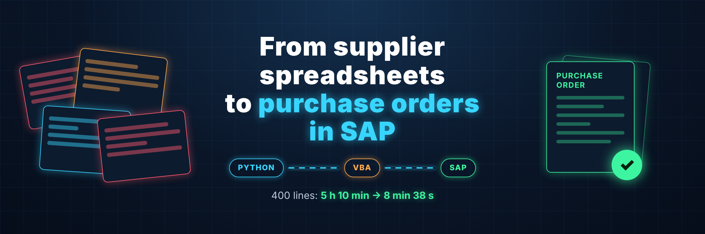
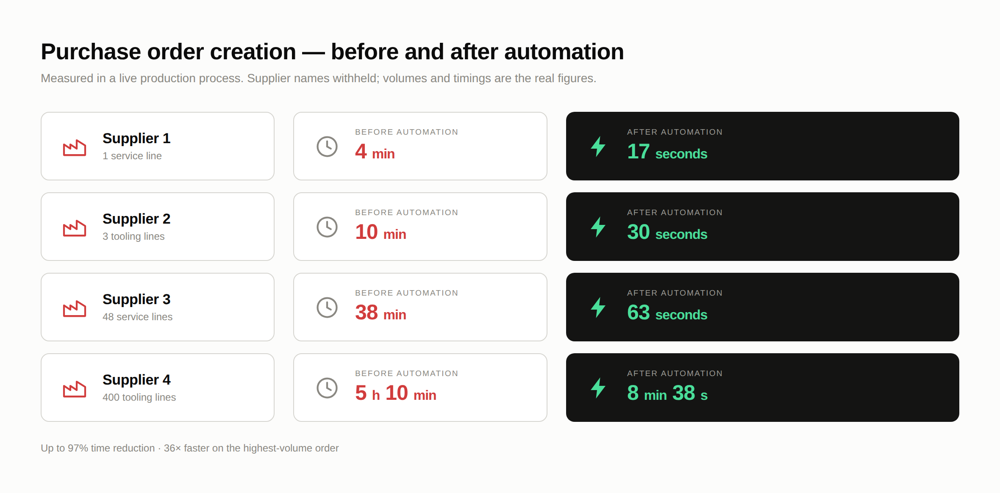
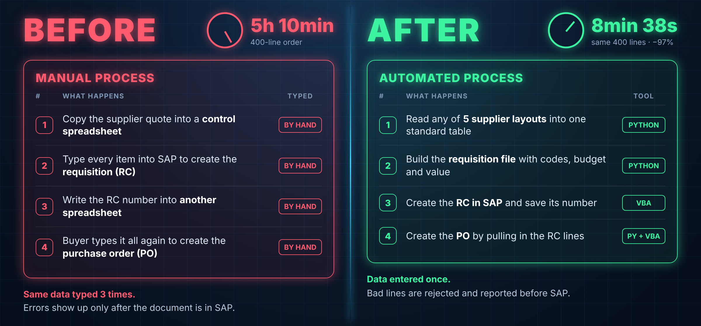
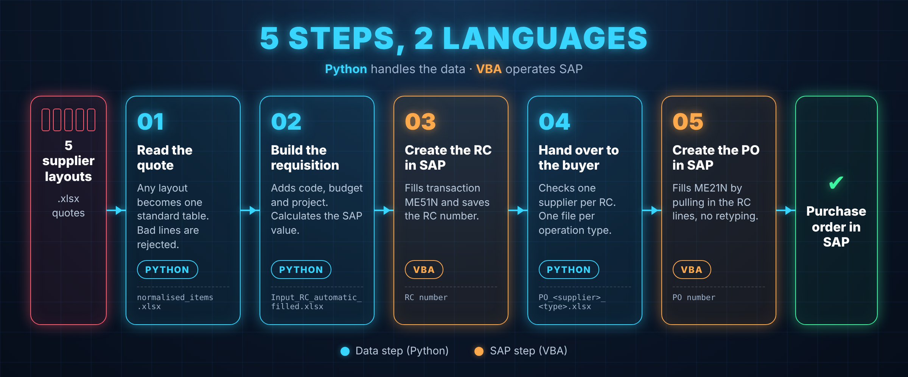
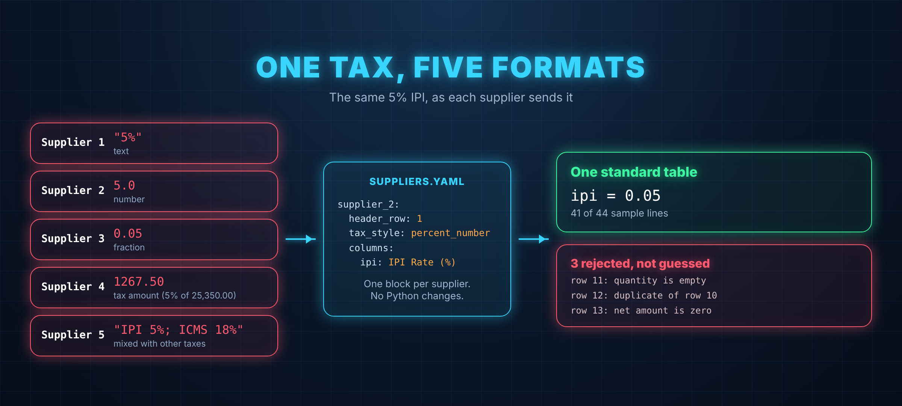

# SAP Purchasing Automation

Turns supplier quote spreadsheets into purchase orders in SAP, with no retyping. The original version ran in production at an automotive manufacturer and cut a 5-hour task to under 9 minutes.




[](https://github.com/lucasnunesf/sap-automation/actions/workflows/tests.yml)

## At a glance

| | |
|---|---|
| **Result** | Up to 97% less time per order (5 h 10 min → 8 min 38 s on 400 lines), measured in production |
| **My role** | I built the SAP automation (requisition and purchase order). The wider payments project had three people |
| **This repo** | A rebuild from scratch with synthetic data, plus a new step the original never had: reading 5 different supplier formats |
| **Skills** | Data cleaning and validation, ETL with Python, config-driven design, automated testing (pytest, GitHub Actions), SAP GUI Scripting with VBA |
| **Case study** | [Automating the purchasing cycle in SAP](https://lucasnunesf.notion.site/Automating-the-purchasing-cycle-in-SAP-a73917c89c1783d49fb301b2a65ab928) (context and real numbers) |

> **Why a rebuild?** The production code contains company data and system settings, so it can't be published. Everything here is fictional (codes like `PL01`, `MAT-100441`, `PRJ-D90B`), but the design and business rules are the same.

## Results



| Order size | Manual | Automated |
|---|---|---|
| 1 service line | 4 min | 17 s |
| 3 tooling lines | 10 min | 30 s |
| 48 service lines | 38 min | 63 s |
| 400 tooling lines | 5 h 10 min | 8 min 38 s |

Manual time grows with every line. Automated time barely changes, so the bigger the order, the bigger the gain.

## The problem



Suppliers send their prices as spreadsheets, each in their own layout. Before this tool, the same data was typed by hand three times across two teams: into a control sheet, into SAP as a purchase requisition (RC), and again into SAP as a purchase order (PO). Mistakes only showed up once the document already existed in SAP, where fixing it is slow.

<details>
<summary><b>Quick glossary</b> (Brazilian purchasing terms)</summary>

| Term | Meaning |
|---|---|
| RC | Purchase requisition, the internal request to buy. SAP transaction ME51N |
| PO | Purchase order, the document sent to the supplier. SAP transaction ME21N |
| IPI, ICMS | Brazilian taxes on industrial products and on goods and services |
| Tooling / Service | The two operation types. Each gets its own PO |
| GUI Scripting | SAP's built-in way to control its screens from code |

</details>

## How it works



**Python handles the data, VBA operates SAP.** The SAP steps are in VBA because it runs on locked corporate computers where installing Python is often not allowed.

| Step | What it does | Language | Output |
|---|---|---|---|
| 01 Read the quote | Turns any of the 5 supplier layouts into one standard table and rejects bad lines | Python | `normalised_items.xlsx` |
| 02 Build the requisition | Adds internal code, budget and project from the item master and calculates the value SAP expects | Python | `Input_RC_automatic_filled.xlsx` |
| 03 Create the RC | Fills in ME51N and writes the RC number back to the file | VBA | RC number |
| 04 Hand over to the buyer | Joins the RC with the supplier data and creates one file per operation type | Python | `PO_<supplier>_<type>.xlsx` |
| 05 Create the PO | Fills in ME21N by pulling in the RC lines instead of retyping them, the way a buyer does | VBA | PO number |

Each step owns one kind of knowledge. If a supplier changes their spreadsheet, only step 01 is affected.

The two halves belong to different people, so each one works on its own. The admin team runs steps 01 to 04. The buyer runs step 05 and only needs Excel, SAP and one PO file, which carries the supplier, dates, RC numbers, quantities and prices. Neither macro depends on Python or a shared drive.

## Reading messy supplier files



The production version automated the SAP steps, but every supplier still sent their own layout and someone had to convert it by hand. This rebuild solves that with five sample files, each with a real problem:

| Supplier | How the same 5% IPI arrives | Other problems |
|---|---|---|
| 1 | `"5%"` as text | |
| 2 | `5.0` as a number | |
| 3 | `0.05` as a fraction | Headings and subtotal rows mixed into the data, plus planted bad lines |
| 4 | The tax amount in currency | Materials and services split across two sheets |
| 5 | Inside `"IPI 5%; ICMS 18%"` | Quantity, unit and currency packed into one cell |

Each supplier is one block in `shared/suppliers.yaml`:

```yaml
supplier_2:
  name: Supplier 2
  header_row: 1
  decimal_style: dot
  tax_style: percent_number
  columns:
    part_number: Item Code
    quantity: Quantity
    unit_price: Unit Price
    ipi: IPI Rate (%)
```

Adding a supplier means copying a block and changing the column names. A `constants` block fills in values the spreadsheet doesn't have. New items are a new row in `shared/master_data.xlsx`. Neither needs a Python change.

## Design decisions

**Mapping in config, not code.** Supplier layouts change all the time. Keeping them in YAML means the person who knows the supplier can update it without touching Python.

**Reject, never guess.** A missing quantity, a zero price, a duplicate line, an unknown item, a number that isn't in the supplier's configured format, an unknown tax, a blank tax cell or a net amount that doesn't match unit price × quantity is rejected and reported with its file, sheet and row. Layout differences repeat every month, so they are worth automating. Data errors are one-offs, so they are worth reporting, not fixing silently.

**Business rules live in code.** They don't depend on whoever is doing the job that day:

1. Tooling is valued at net price plus IPI. Service is valued with all taxes. (step 02)
2. One RC belongs to one supplier. Step 04 stops and lists the suppliers if it finds more than one, because a mixed RC would silently create wrong POs.
3. One PO covers one operation type, so an RC creates at most two POs.

**Reuse what SAP already has.** Step 05 pulls in the RC lines instead of typing them again. Less typing means fewer errors, and it matches how buyers actually work.

## Try it

Steps 01, 02 and 04 run on the sample data without SAP.

```bash
git clone https://github.com/lucasnunesf/sap-automation.git
cd sap-automation
pip install -r requirements.txt

cd 01-supplier-intake/src
python intake.py --input ../sample_data/supplier_2.xlsx

cd ../../02-requisition-builder/src
python build_requisition.py --input ../../01-supplier-intake/src/normalised_items.xlsx
```

Output:

```
Stage 01 - supplier intake
10 lines read
10 normalised
0 rejected

Stage 02 - requisition builder
10 normalised lines read
10 written (7 tooling, 3 service)
0 rejected
```

To see all five formats at once and the rejection report, run step 01 with `--input ../sample_data/ --all`:

```
44 lines read
41 normalised
3 rejected

Rejected lines:
  supplier_3.xlsx [QUOTE] row 11: quantity is empty; net amount is zero
  supplier_3.xlsx [QUOTE] row 12: duplicate of row 10
  supplier_3.xlsx [QUOTE] row 13: net amount is zero
```

Step 04 needs the RC numbers that SAP returns in step 03. Without SAP, you can type any number into cell `K2` of the Tooling and Service sheets of `Input_RC_automatic_filled.xlsx`, then run:

```bash
cd ../../04-po-handover/src
python po_handover.py \
    --requisition ../../02-requisition-builder/src/Input_RC_automatic_filled.xlsx \
    --normalised  ../../01-supplier-intake/src/normalised_items.xlsx
```

```
10 requisition lines read
2 purchase orders generated
0 lines held back

Files written:
  PO_SUP-10045_MATERIAL.xlsx (7 lines)
  PO_SUP-10045_SERVICE.xlsx (3 lines)
```

If you run it on the all-suppliers output, step 04 stops on purpose with an error, because the RC would mix five suppliers.

## Tests

104 automated tests run on every push with GitHub Actions:

| File | What it checks |
|---|---|
| `test_parsers.py` | Every number and tax format from the five suppliers ends up as the same value |
| `test_business_rules.py` | The three business rules and every rejection reason |
| `test_strict_parsing.py` | A number outside the supplier's format, an ambiguous quantity or an unknown tax rejects the line instead of becoming a wrong value |
| `test_validation.py` | Net amount against unit price × quantity, and a blank tax cell (missing) against "-" or 0 (doesn't apply) |
| `test_pipeline.py` | Steps 01, 02 and 04 end to end on each sample supplier, with the SAP step simulated |

```bash
pip install pytest
pytest
```

The end-to-end tests caught a real bug: step 04 refused a mixed-supplier requisition but still exited as a success, so a scheduler running it would never notice. It now exits with an error code.

Making the number parser strict caught a second one in the sample data: supplier 5 is configured with comma decimals but wrote `PIS/COFINS 9.25%`. The old parser read 925%, and the three service lines went to the SAP file at about ten times their value (162,740.00 instead of 18,051.50 for the first one). The sample now says `9,25%`, and a test checks the three values.

<details>
<summary><b>Running the VBA steps in SAP</b></summary>

Import the `.bas` files into an Excel workbook through the VBA editor (`Alt + F11`, then File > Import File). They need an open SAP session with GUI scripting enabled on both client and server, and should run against a test environment.

The SAP screen paths at the top of each module change between SAP versions. Record them once in your own system with the SAP GUI script recorder and replace the constants.

</details>

<details>
<summary><b>Repository structure</b></summary>

```
sap-automation/
├── 01-supplier-intake/
│   ├── src/intake.py              # supplier quote -> standard table
│   └── sample_data/               # five layouts, same required fields
├── 02-requisition-builder/
│   └── src/build_requisition.py   # standard table -> requisition file
├── 03-requisition-sap/
│   └── src/RequisitionSAP.bas     # requisition file -> SAP ME51N
├── 04-po-handover/
│   └── src/po_handover.py         # requisition -> purchase order files
├── 05-purchase-order-sap/
│   └── src/PurchaseOrderSAP.bas   # purchase order file -> SAP ME21N
├── shared/
│   ├── suppliers.yaml             # supplier layout mapping
│   ├── parsers.py                 # reads messy values (taxes, decimals, units)
│   ├── item_master.py             # item master access, used by steps 02 and 04
│   ├── master_data.xlsx           # item master
│   ├── Input_RC_automatic.xlsx    # requisition template
│   └── Input_PO_automatic.xlsx    # purchase order template
├── tests/                         # pytest suite, runs in GitHub Actions
├── docs/                          # images used in this README
└── requirements.txt
```

</details>

## Tech stack

Python 3.11 (openpyxl, PyYAML, pytest) · GitHub Actions · VBA · SAP GUI Scripting · Excel

## Next steps

- [x] Automated tests for parsing, business rules and the pipeline
- [ ] Replace the file handover between steps with a database table
- [ ] Move the RC and PO layouts into configuration too

## How this was built

The problem, the business rules and the design decisions are mine. They come from my work in purchasing at Toyota do Brasil. I used an AI coding assistant to write the code faster and reviewed the result.

<!-- Lucas: write here, in your own words, one or two sentences about where you saw this problem happen. -->

## Author

**Lucas Fernandes Nunes** · Data & BI Analyst · moving to Lisbon in February 2027
[LinkedIn](https://linkedin.com/in/lucas-fernandes-nunes-335867256) · [Portfolio](https://lucasnunesf.notion.site)
